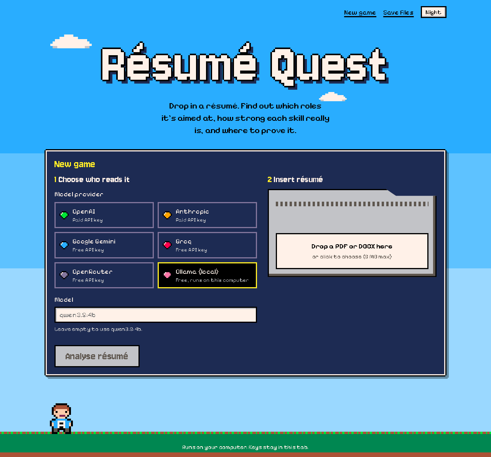
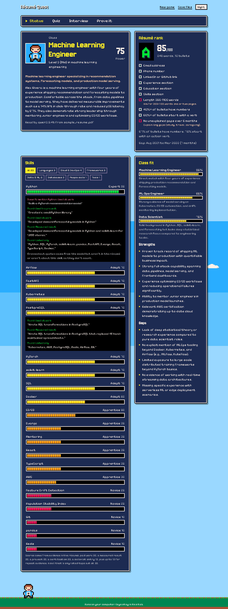
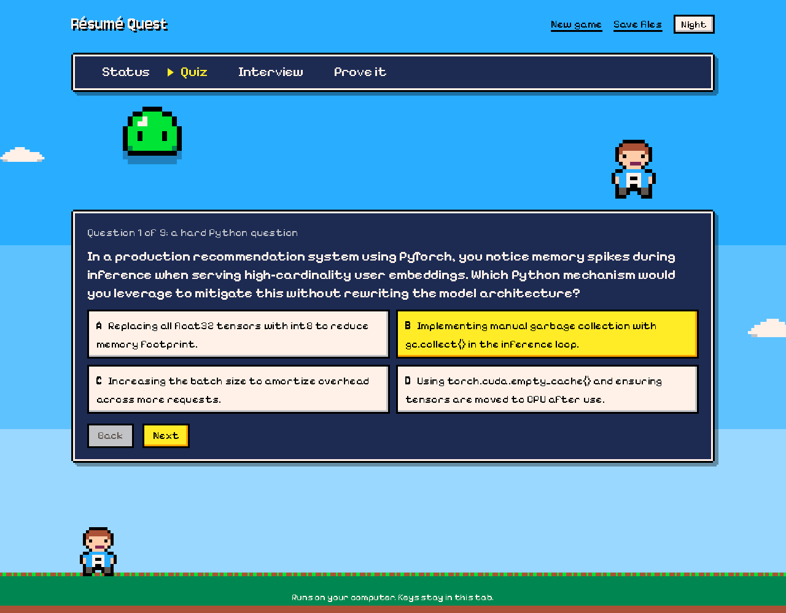
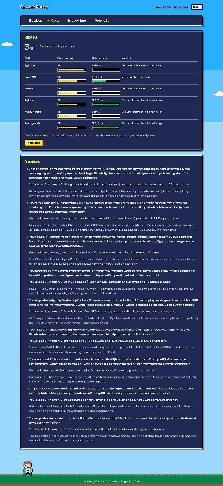
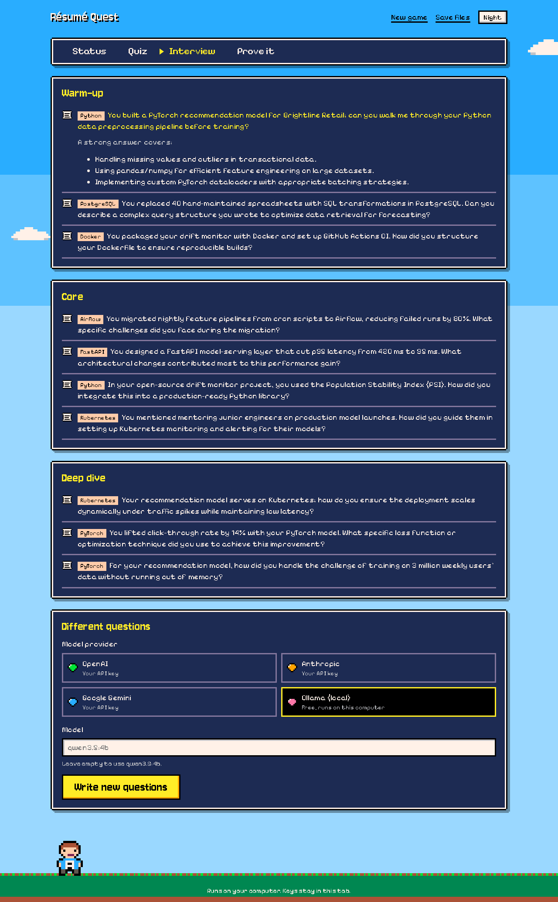
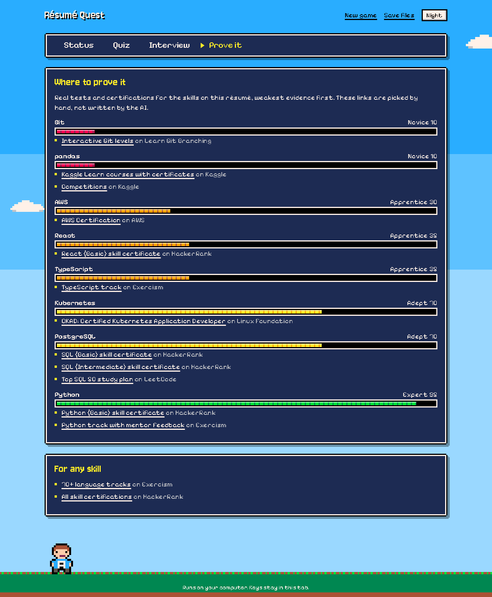
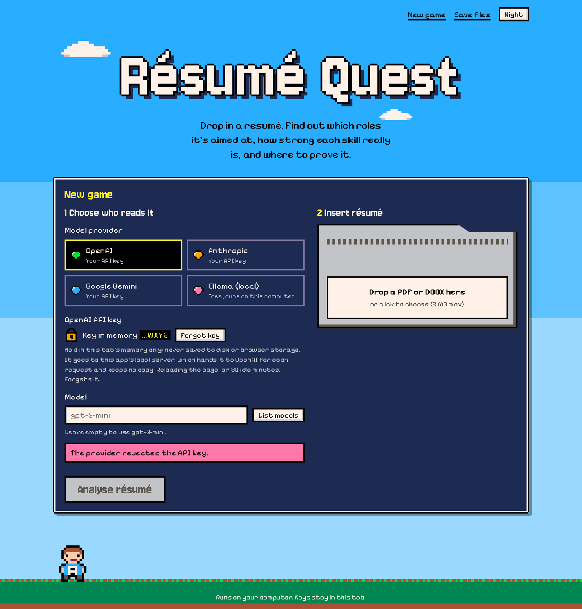

# Résumé Quest

[](https://github.com/vxkram/resume-quest/actions/workflows/ci.yml)

A local résumé analyser with a pixel-art RPG interface. Drop in a PDF or DOCX résumé and it tells you:

- **What the résumé is for:** the three job titles it's best aimed at, with a confidence score each, plus seniority and domain.
- **How strong each skill really is:** every skill gets a 0–100 score from evidence the app has *checked against the résumé text*, not from the model's opinion.
- **How good the résumé is as a document:** sections, contact details, quantified bullets, action verbs, length and employment gaps, ranked S to D.
- **How to test the person:** a generated multiple-choice quiz that compares "claimed" with "demonstrated", interview questions from warm-up to deep dive, and hand-picked links to real tests and certifications.

It works with **OpenAI, Anthropic, Google Gemini, Groq, OpenRouter, or a local Ollama model**. Cloud API keys are pasted into the page, held only in that tab's memory, and never stored anywhere. See [API key safety](#api-key-safety).

### Free ways to run it

| Provider | Cost | Notes |
|---|---|---|
| **Ollama** | Free, no key | Runs on your own computer. Nothing leaves your machine. |
| **Google Gemini** | [Free key](https://aistudio.google.com/apikey) | Several Flash models have a free tier (default `gemini-2.5-flash`). Google may use free-tier prompts to improve its products. |
| **Groq** | [Free key](https://console.groq.com/keys) | Very fast. Default `openai/gpt-oss-120b`, which enforces the JSON schema. Other Groq models run in plain JSON mode. |
| **OpenRouter** | [Free key](https://openrouter.ai/keys) | Default `openrouter/free` picks a free model that supports structured output. Free models allow 20 requests a minute and 50 a day; one analysis uses one request. |
| OpenAI, Anthropic | Paid | An API key with billing set up. A ChatGPT or Claude subscription doesn't include API credit. |

Free tiers change often, so check each provider's limits before relying on them. When a free quota runs out, the app says so instead of telling you to retry.

**Stack:** Django 5.2 + Django REST Framework · React 19 + Vite · SQLite · pdfminer.six / python-docx

| Title screen | Status screen |
|---|---|
|  |  |

| Quiz | Claimed vs demonstrated |
|---|---|
|  |  |

| Interview questions | Where to prove it |
|---|---|
|  |  |

| Key in memory | Night, on a phone |
|---|---|
|  |  |

All screenshots come from a real run against the fictional [sample résumé](samples/sample_resume.txt), using the local `qwen3.5:4b` model through Ollama.

## How the analysis works

```
upload ─► text extraction ─► LLM (JSON schema) ─► verify + score ─► SQLite
 PDF/DOCX   in memory only     role fits, skills,    quotes checked against the résumé,
 ≤ 5 MB     type from bytes    evidence quotes       résumé scanned for every mention,
                                                     fixed scoring formula, quality checks
```

1. **Extraction.** The file type is detected from its bytes (not its name or content type), parsed in memory, and thrown away. Only the text is kept. Unmapped PDF glyphs like `(cid:127)` are turned back into bullets.
2. **One structured LLM call.** Each provider's native structured-output mode returns JSON matching a fixed schema: OpenAI `json_schema` (strict), Anthropic `output_config.format`, Gemini `response_json_schema`, Groq and OpenRouter `response_format` json_schema (OpenRouter only routes to upstreams that honour it), Ollama `format`. Pydantic validates the result; a malformed answer is retried once, then reported cleanly.
3. **Evidence is checked, not trusted.** A skill only scores from evidence that passes two tests:
   - the quote really is in the résumé (normalised, with a 90% fuzzy match to absorb PDF line-wrap noise), **and**
   - it actually names the skill. A real résumé line about PyTorch is not evidence for Python.

   Quotes that fail stay visible in the UI, crossed out, with the reason. The résumé is also scanned for every line that names the skill, and each line is typed by its section, so a weak model that returns one quote still gets the skill scored properly.
4. **A fixed, published formula.** The first piece of evidence of each kind scores: paid work 35, a measured result 25, a project 25, a certification 20, a skills-list entry 10. Repeat evidence adds +5 each, up to +10. A skill that's only ever listed is capped at 30. Levels: Expert 80+, Adept 55+, Apprentice 30+, Novice 1+, Unproven 0.
5. **Résumé quality is pure Python.** No model is involved, so it's instant and repeatable.

**Testing the person:**

- **Quiz.** The model writes 8 questions on the strongest claimed skills, harder where the claim is stronger. The server shuffles each question's options (small models put the right answer at "B" far too often), keeps the answer key until you submit, then grades per skill as *matches the résumé*, *better than the résumé says*, or *résumé claims more than this*.
- **Interview questions.** 9–12 questions tied to the résumé's own claims, each with what a strong answer covers.
- **Where to prove it.** A curated map from skill aliases to real assessments: HackerRank skill certificates, Exercism tracks, LeetCode, Codeforces, Kaggle, and the AWS, Azure, Google Cloud, Linux Foundation and HashiCorp certifications. The links are never generated by the model, and every one was opened and checked when added.

## API key safety

Keys for cloud providers are entered in the page and live **only in React state in that browser tab**.

| Where a key could leak | What happens |
|---|---|
| Browser storage | Never written to localStorage, sessionStorage, IndexedDB, cookies or the URL. Only the provider and model *names* are remembered. Reloading the page, or 30 idle minutes, forgets the key. |
| Password managers / spellcheck | `type=password` input, not inside a `<form>`, with autocomplete, autocorrect and spellcheck off and the common password-manager opt-out attributes. |
| The screen | Once entered, only the last four characters are shown (`…WXYZ`). |
| The network | Sent only to this app's own server, only as an `X-LLM-Key` request header, only on requests that call a model. Never in a URL or body, so it can't end up in an access log. |
| The server | Read from the header, handed to the provider SDK, and dropped when the request ends. Never saved to the database, a file or a cache. |
| Logs and error pages | A log filter redacts any key seen in the current request, plus anything shaped like an OpenAI, Anthropic, OpenRouter, Groq or Google key, including inside tracebacks. Django's error reports hide the header and any local variable holding a key. Provider errors are mapped to fixed messages ("The provider rejected the API key."), so an SDK message that quotes your key never reaches the browser. |
| Other websites | No CORS. The page and the API share one origin. Every state-changing request must carry a custom `X-Resume-Quest` header, which another site can't add without a CORS preflight this server never approves. `ALLOWED_HOSTS` is localhost-only, which also blocks DNS rebinding. |
| Injected scripts | Strict Content-Security-Policy: `script-src 'self'`, no inline scripts, no CDNs. Fonts are self-hosted, so no third-party code ever runs on the page holding your key. |

This is enforced by tests, not just described. [`test_key_safety.py`](resume_summarizer_backend/analyzer/tests/test_key_safety.py) pushes a sentinel key through every endpoint, then asserts it appears in no response, database row, log line or file written under the project. It also covers a provider error that quotes the key and a crash whose message contains it. [`key-safety.test.jsx`](resume_summarizer_frontend/src/test/key-safety.test.jsx) checks that browser storage never holds the key. The same was confirmed in real Chromium with Playwright: the key appeared in exactly one place, the `X-LLM-Key` header of the request that needed it.

**What this doesn't protect against:** malware on your computer, or a browser extension that can read every page. The server binds to `127.0.0.1` and is meant to be used only on your own machine. If you ever put it on a network, serve it over HTTPS and add authentication first.

## Running it

You need Python 3.12 and Node 20+. For the free local option, install [Ollama](https://ollama.com) and pull a model (`ollama pull qwen3.5:4b`). Any chat model works; bigger ones give better answers.

```bash
./run.sh
```

That creates `.venv`, writes `resume_summarizer_backend/.env` with a fresh secret key (mode 600), builds the frontend, migrates the database, and serves everything at **http://127.0.0.1:8000**. Set `PYTHON=python3.12` if your default `python3` is newer.

<details>
<summary>Manual setup, or on Windows</summary>

```bash
python -m venv .venv
.venv/bin/pip install -r requirements.txt          # .venv\Scripts\pip on Windows
cp resume_summarizer_backend/.env.example resume_summarizer_backend/.env
# set DJANGO_SECRET_KEY in that file

cd resume_summarizer_frontend && npm ci && npm run build && cd ..
cd resume_summarizer_backend
../.venv/bin/python manage.py migrate
../.venv/bin/python manage.py runserver 127.0.0.1:8000
```
</details>

**Frontend development:** run the backend as above with `DJANGO_DEBUG=True`, then `npm run dev` in `resume_summarizer_frontend/` and open http://127.0.0.1:5173. Vite proxies `/api` to Django, so it stays same-origin.

## Tests

```bash
.venv/bin/pip install -r requirements-dev.txt
cd resume_summarizer_backend && ../.venv/bin/pytest      # 102 tests
cd resume_summarizer_frontend && npm test                # 13 tests
```

The backend tests never call a real model. Each provider adapter is tested against a mocked SDK (request shape, error mapping, refusals), and the API runs end to end with an offline keyword-matching provider that only exists when `ENABLE_FAKE_PROVIDER=True`. CI runs both suites and the production build on every push.

## Layout

```
resume_summarizer_backend/
  analyzer/
    llm/              one adapter per provider (Groq and OpenRouter share an
                      OpenAI-compatible one) + the shared JSON call with retry
    extract.py        PDF/DOCX → text, in memory
    analytics.py      quote verification, résumé scan, skill scoring, quality checks
    testing.py        quiz targets, option shuffling, grading
    external_tests.py curated skill → assessment links
    security.py       key handling, log redaction, CSP, error responses
    tests/
resume_summarizer_frontend/
  src/screens/        title, status, quiz, interview, prove it, save files
  src/session.jsx     provider, model and in-memory keys
samples/              fictional sample résumé (txt, PDF, DOCX) + the script that renders it
```

## Known limitations

- The Ollama path is verified end to end against a real model. The cloud adapters are verified against mocked SDKs. OpenAI, Groq and OpenRouter were also checked against their real APIs' "invalid key" responses, and OpenRouter's live free-model list. None has had a successful run with a real key yet.
- Quality depends on the model. A 4B local model gets role fits and categories right but writes the occasional shaky quiz question. The verification and scanning steps exist so that skill scores don't depend on it.
- Scanned (image-only) PDFs have no text layer and are rejected rather than OCR'd.
- Quiz verdicts rest on one to three questions per skill: a prompt to dig in, not a judgement.
- Analyses, including the résumé text, are stored in a local SQLite file. Delete them from the Save files screen.

## License

MIT. See [LICENSE](LICENSE). Fonts: Jersey 10 and Pixelify Sans, both SIL Open Font License, bundled via Fontsource.
